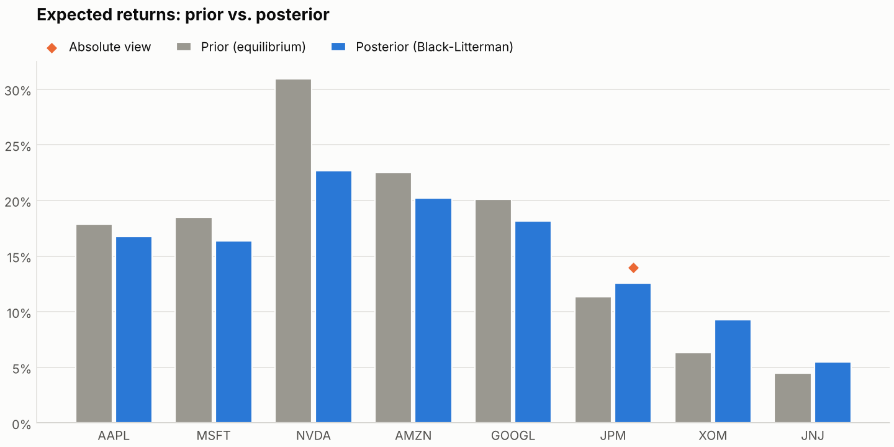
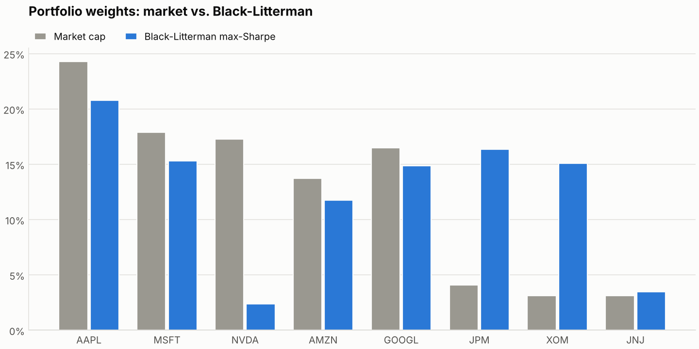
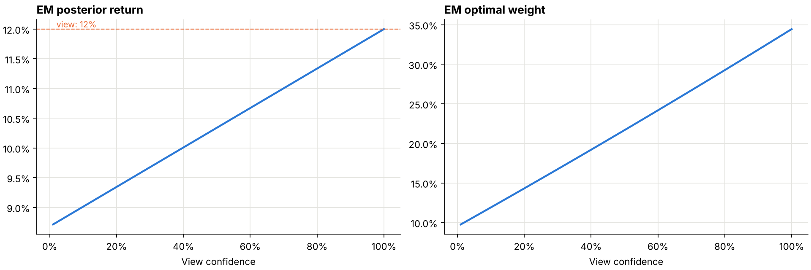
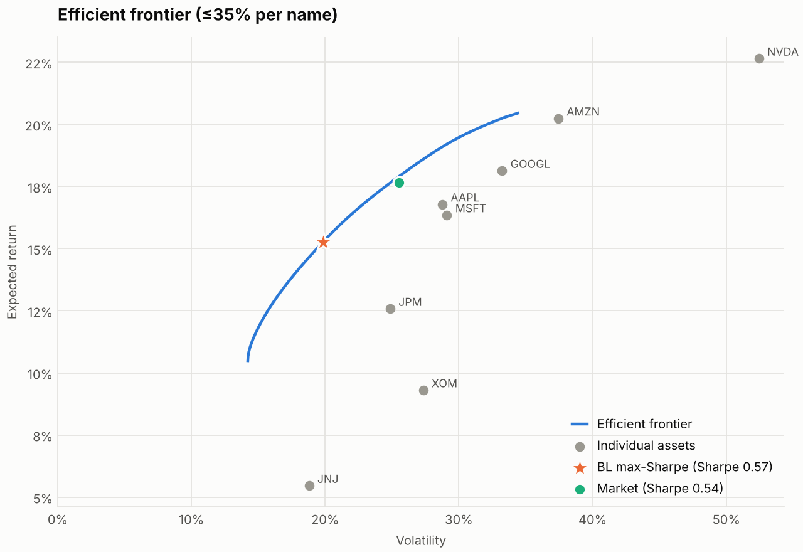

# Black-Litterman Portfolio Construction

[](https://github.com/zoniin/Black-Litterman-Model/actions/workflows/ci.yml)

[](LICENSE)

A small, tested Python implementation of the **Black-Litterman model**. It takes market-implied equilibrium returns, blends in your views with a Bayesian update, and turns the result into portfolios with convex optimisation.

Plain mean-variance optimisation takes historical mean returns at face value. The usual result is an extreme, unstable portfolio that piles into whichever asset had a good few years. Black-Litterman starts from the portfolio the market already holds and moves away from it only where you have an opinion, by an amount set by how confident you are.

<p align="center">
  
  
</p>

*Eight US large caps with three illustrative views: JPM returns 14% (60% confident), XOM beats NVDA by 5% (40%), and an equal JNJ/GOOGL basket returns 12% (30%). Weights move only where the views point. Produced by [`examples/quickstart.py`](examples/quickstart.py).*

## Highlights

- **Correct and numerically stable.** The posterior uses the update form that never inverts $\Sigma$ or $\Omega$, so a 100%-confidence view is exact rather than a division by zero. Tests check it against the textbook master formula to 1e-10.
- **Intuitive confidence.** Each view takes a 0-100% confidence (Idzorek, 2005), through Walters' closed form. At confidence $c$, the posterior moves *exactly* a fraction $c$ of the way to the 100%-certain view. A test checks this.
- **A real max-Sharpe optimiser.** The Cornuejols-Tütüncü transform turns the non-convex Sharpe ratio into a QP, so it works with weight bounds. Tests check the result against the closed-form tangency portfolio. Min-volatility, target-return, quadratic utility and a parametrised efficient frontier are included too.
- **Label-aware.** Pass pandas objects and write views by ticker. Outputs come back as labelled `Series`/`DataFrame`s.
- **Sound data handling.** Prices are adjusted closes that are forward-filled and never back-filled, so there is no look-ahead. A dependency-free Ledoit-Wolf shrinkage estimator matches scikit-learn exactly. A missing market cap raises an error instead of being silently replaced with a placeholder.
- **58 tests, 96% coverage**, with CI on Python 3.10-3.13. The tests check textbook identities, not just that the code runs (see [Testing](#testing)).

## Install

```bash
git clone https://github.com/zoniin/Black-Litterman-Model.git
cd Black-Litterman-Model
pip install -e ".[plot,data]"     # core needs only numpy, pandas, cvxpy
```

## Quick start

```python
from blacklitterman import BlackLitterman, ledoit_wolf, max_sharpe, returns_from_prices
from blacklitterman.data import fetch_prices, fetch_market_caps, market_implied_risk_aversion

tickers = ["AAPL", "MSFT", "NVDA", "AMZN", "GOOGL", "JPM", "XOM", "JNJ"]
prices = fetch_prices([*tickers, "SPY"], period="5y")
cov = ledoit_wolf(returns_from_prices(prices[tickers]))
delta = market_implied_risk_aversion(prices["SPY"], risk_free_rate=0.04)

bl = BlackLitterman(cov, market_caps=fetch_market_caps(tickers), risk_aversion=delta, tau=0.05, risk_free_rate=0.04)

bl.add_absolute_view("JPM", 0.14, confidence=0.6)  # JPM returns 14%
bl.add_relative_view("XOM", "NVDA", 0.05, confidence=0.4)  # XOM beats NVDA by 5%
bl.add_view({"JNJ": 0.5, "GOOGL": 0.5}, 0.12, confidence=0.3)  # any linear view

bl.summary()  # market weight, prior, posterior, view impact, BL weight per asset
bl.view_summary()  # each view vs. what the prior and posterior imply

weights = max_sharpe(bl.posterior_returns(), bl.posterior_cov(), risk_free_rate=0.04, bounds=(0, 0.35))
```

Run the whole pipeline and regenerate the figures with:

```bash
python examples/quickstart.py --save docs/images
```

For a guided tour, see [`notebooks/walkthrough.ipynb`](notebooks/walkthrough.ipynb). It covers the equilibrium prior, how a single view propagates, what "confidence" means, and a run on live data.

## The model

**Prior.** If the market-cap-weighted portfolio $w_{mkt}$ is optimal for an investor with risk aversion $\delta$, expected returns must be

$$\Pi = r_f + \delta\,\Sigma\,w_{mkt}.$$

**Views.** Each view is a linear statement $p_k^\top \mu = q_k$ with uncertainty $\Omega_{kk}$. Stack them into $P$, $Q$ and $\Omega$.

**Posterior.** Combining the prior $\mu \sim N(\Pi, \tau\Sigma)$ with the views gives

$$\mu_{BL} = \Pi + \tau\Sigma P^\top \left(P\tau\Sigma P^\top + \Omega\right)^{-1}(Q - P\Pi)$$

$$\Sigma_{BL} = \Sigma + \tau\Sigma - \tau\Sigma P^\top \left(P\tau\Sigma P^\top + \Omega\right)^{-1} P\tau\Sigma$$

This is algebraically identical to the familiar $[(\tau\Sigma)^{-1} + P^\top\Omega^{-1}P]^{-1}[(\tau\Sigma)^{-1}\Pi + P^\top\Omega^{-1}Q]$. It only inverts a small $k \times k$ matrix and stays well-defined when $\Omega$ is singular.

**Confidence.** View uncertainty can be given three ways:

| Argument | $\Omega_{kk}$ | Meaning |
|---|---|---|
| `confidence=c` | $\frac{1-c}{c}\, p_k \tau\Sigma p_k^\top$ | Posterior moves fraction $c$ toward the view (Idzorek / Walters) |
| *(neither)* | $p_k \tau\Sigma p_k^\top$ | He-Litterman default, the same as `confidence=0.5` |
| `omega=v` | $v$ | Set the view variance yourself |

<p align="center"></p>

**Weights.** The unconstrained optimum $w^* = (\delta\Sigma_{BL})^{-1}(\mu_{BL} - r_f)$ equals $w_{mkt}/(1+\tau)$ plus a combination of the view portfolios. This is why assets you have no view on keep their market weight (`bl.implied_weights()`). For long-only or bounded portfolios, pass the posterior to any optimiser in `blacklitterman.optimize`.

<p align="center"></p>

## API overview

| Module | Contents |
|---|---|
| `blacklitterman.model` | `BlackLitterman`: `add_absolute_view`, `add_relative_view`, `add_view`, `posterior_returns`, `posterior_cov`, `implied_weights`, `summary`, `view_summary` |
| `blacklitterman.optimize` | `max_sharpe`, `min_volatility`, `efficient_return`, `max_quadratic_utility`, `efficient_frontier`, `portfolio_performance` |
| `blacklitterman.risk` | `returns_from_prices`, `sample_cov`, `ledoit_wolf`, `cov_to_corr` |
| `blacklitterman.data` | `fetch_prices`, `fetch_market_caps`, `market_implied_risk_aversion` (needs `yfinance`) |
| `blacklitterman.plotting` | `plot_returns`, `plot_weights`, `plot_efficient_frontier`, `plot_correlation` |

All returns are annualised, arithmetic and in decimals (0.08 = 8%). Priors, absolute views and posteriors are total returns. Relative views are spreads.

## Testing

```bash
pip install -e ".[dev]"
pytest --cov=blacklitterman
ruff check . && ruff format --check .
```

The tests check the maths against known results:

- With no views, the posterior equals the prior and optimal weights equal $w_{mkt}/(1+\tau)$ (He & Litterman, 1999).
- The update form matches the master formula, for both returns and covariance.
- 100%-confidence absolute and relative views hold exactly.
- Idzorek's linear-tilt property holds at several confidence levels.
- Weight tilts lie in the span of $P^\top$, and assets without views keep their market weight.
- `max_sharpe`, `min_volatility` and `max_quadratic_utility` match their closed forms when unconstrained. Long-only `max_sharpe` beats 2,000 random portfolios, and the tangency portfolio lies on the frontier.
- `ledoit_wolf` matches `sklearn.covariance.LedoitWolf`.
- The data layer runs against a fake `yfinance`, so CI never touches the network. It checks adjusted prices, no back-fill, and an error on a missing cap.

## References

- Black, F. & Litterman, R. (1992). *Global Portfolio Optimization.* Financial Analysts Journal, 48(5).
- He, G. & Litterman, R. (1999). *The Intuition Behind Black-Litterman Model Portfolios.* Goldman Sachs.
- Idzorek, T. (2005). *A Step-by-Step Guide to the Black-Litterman Model.*
- Walters, J. (2014). *The Black-Litterman Model in Detail.* SSRN 1314585.
- Cornuejols, G. & Tütüncü, R. (2006). *Optimization Methods in Finance.* Cambridge University Press.
- Ledoit, O. & Wolf, M. (2004). *A well-conditioned estimator for large-dimensional covariance matrices.* J. Multivariate Analysis, 88(2).

## License

MIT. See [LICENSE](LICENSE). Nothing here is investment advice.
